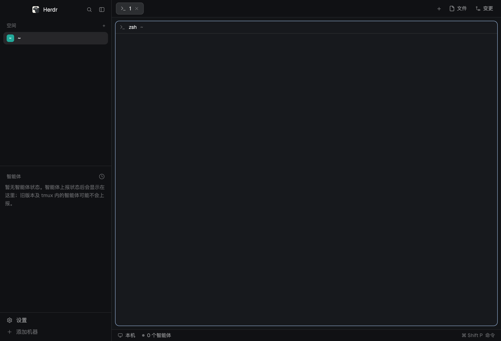

# 简体中文 (main-zh)

Herdr 默认 `main` 布局的简体中文版：结构、配色、行为与 `main` 完全相同，只是侧边栏、标签栏、窗格头、菜单、Files / Changes 面板、状态栏和几个对话框里写死在 mod 代码中的英文界面文字被换成了简体中文。Herdr 没有语言包，所以这是通过克隆 `main` 布局和它用到的 mod 做出来的。

## What you see

与 `main` 相同的布局，文字为中文：

- **左侧栏**（宽 268px，背景 `chrome`，不可拖拽缩放）
  - 顶部 46px 品牌条：Herdr 图标与名称、搜索按钮（跳转对话框）、折叠按钮。
  - 「空间」列表：标题「空间」，右侧 `+`；多台机器时按机器分组，本机显示为「本机」，每组有「在此机器新建空间」。
  - 「智能体」列表：标题「智能体」，右侧排序按钮（「按优先级」/「按空间分组」）；按优先级分组为「需要你 / 已完成 / 进行中 / 空闲」，置顶组为「已置顶」；没有智能体时显示「暂无智能体状态……」。
  - 底部 69px：「设置」与「添加机器」。
- **右侧工作区**
  - 42px 标签栏：标签胶囊、`+`（新建菜单）、「文件」「变更」两个面板按钮。
  - 窗格为圆角卡片（gap 8、radius 10、1px 边框，聚焦时 `accent` 边框），30px 窗格头（中文：「需要你」徽标）。
  - 右侧面板（默认隐藏，368px，280–900px）：「文件」与「变更」。
  - 28px 状态栏：「本机」、`N 个智能体`、`· N 个需要你处理`、右侧 `⌘ Shift P  命令`。

## How it behaves

行为与 `main` 一致，没有改任何命令、id 和逻辑：

- 智能体状态 working / blocked / done / idle 的外观不变（旋转图标、`blocked` 色徽标和圆点、`done` 圆点）。
- `+` 菜单：「终端」、「启动智能体」（未安装的显示「未安装」）、「新建空间」、「新建工作树…」、「打开工作树…」。
- 右键菜单：窗格（向右/向下拆分、缩放、使用 Herdr 右键菜单 / 右键交给窗格内程序、关闭窗格）、标签（重命名、新建标签页、关闭）、空间（重命名、新建/打开/移除工作树、关闭）。
- 「变更」面板：「提交说明」输入框与「提交」按钮；「文件」面板：目录树与只读预览。

## Built from

- `layouts/main-zh.json`：`main.json` 的逐字副本，只把每个 `content.mod` 换成 `-zh` 副本：`workspace-chrome-zh`（品牌条与底部）、`spaces-zh`、`agents-zh`、`tabs-zh`、`pane-zh`（窗格头）、`files-zh`、`changes-zh`、`workspace-status-zh`。
- `mods/` 下 13 个 mod，都是 Herdr 0.1.9 自带 mod 的克隆：上述 8 个，加上被它们打开的 `menu-zh`、`new-menu-zh`、`worktree-zh`、`machine-add-zh`、`picker-zh`。
- 克隆方式：`herdr-app do layout.clone '{"name":"main","as":"main-zh"}'` 和 `mod.clone`；克隆会把副本自己的 `mods/<name>/` 资源路径和自开 overlay 名改成 `-zh`。副本之间互相打开的 mod 名（`openOverlay({mod})`、`run("mod.open",{name})`）、跨 mod 的 `mods/<name>/*.svg` 引用也都要改成 `-zh`。
- 只翻译用户可见的字符串（`child(...)`、`placeholder`、`tooltip`、`mod.json` 的 `title`、错误提示）。不要翻译命令名、id、`shared` 键、`status` 值（如 `"adding"`、`"blocked"`）、`git` 参数。
- 用到的 `herdr` 能力与官方 mod 相同：`exec`（git、ssh 相关）、`hc`、`watchFolder`、`pickFolder`、`openOverlay`、`run`。`files-zh`、`changes-zh`、`spaces-zh`、`worktree-zh`、`picker-zh`、`menu-zh`、`machine-add-zh` 会运行程序（主要是 `git`，`machine-add-zh` 会让 `hc machine add` 经 ssh 连接）；不访问网络。

## Watch out

- 确认框（`confirm`）、`prompt`、`help`、`toast` 由程序按名字打开，布局无法指向副本，所以这些以及 `frame/`（设置、欢迎、命令面板、反馈、更新说明）仍是英文；「Close space?」之类的标题由程序传入，也无法翻译。
- 品牌名 "Herdr"、主题名（graphite、ink、moss、atom one dark）、终端内 agent 的输出、来自 git/系统的错误信息保持原文。
- `herdr-app check` 对 `changes-zh` 会崩溃（`gpui window.rs unwrap on None`），官方 `changes` 同样如此；其余 12 个 mod 通过。
- 这是克隆：Herdr 更新后官方 `main` 的改动不会自动同步，需要重新克隆翻译。
- 克隆后若副本互相引用的名字没改，布局会指向官方英文 mod 或报找不到 mod。
- 时间简写已改为中文（`分`、`时`、`天`；工作树用 `分钟`、`小时`、`天`、`个月`）。

## Done when

1. `layouts/main-zh.json` 中所有 `"mod"` 值都以 `-zh` 结尾，且每个都存在于 `mods/`。
2. `grep -rn 'mod: *"' mods/*-zh` 中每个目标都是 `-zh`；`mod.open` 的 `name` 也是。
3. 除 `changes-zh` 外，`herdr-app check ~/.config/herdr-app/mods/<name>` 对每个 mod 都通过。
4. `herdr-app do layout.switch '{"name":"main-zh"}'` 后，`herdr-app status` 的 `errors` 为空，窗口显示「空间」「智能体」「设置」「添加机器」「文件」「变更」和状态栏「本机 / N 个智能体」。
5. 打开 `+` 菜单看到「终端」「启动智能体」「新建空间」；右键标签看到「重命名」「新建标签页」「关闭」。
6. `cmd-shift-l`（macOS）或 `layout.switch {"name":"main"}` 可切回英文 `main`。
